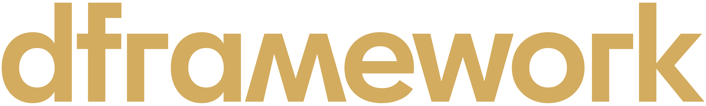

<p align="center">
  <a href="https://framework.dstrn.xyz" target="_blank"></a>
</p>
<p align="center">
アーキテクチャの一貫性、決定論的な振る舞い、そして高いパフォーマンスを中心に構築された完全統合型JavaScriptアプリケーションフレームワーク。
</p>

<p align="center">
  <a href="https://github.com/dstrn-xyz/framework/actions"></a>
  
  <a href="https://raw.githubusercontent.com/dstrn-xyz/docs/refs/heads/main/LICENSE"></a>
  
  <a href="https://dstrn.xyz"></a>
</p>

## dframeworkについて

dframeworkはアーキテクチャの一貫性と決定論的な振る舞いを強制するオピニオネイテッドなフレームワークです。ルーティング、レンダリング、コンポーネント、スタイリング、アセット、状態管理、コンパイル、トランスポート、ネイティブランタイム統合を含む完全なアプリケーションライフサイクルを制御します。

プラグインエコシステム、アダプター層、競合するアーキテクチャパターンは意図的に排除されています。dframeworkは部分的な導入ではなく、完全なフレームワークとして使用されるように設計されています。

<a name="dframeworkの対象開発者"></a>

# dframeworkの対象開発者

dframeworkは統合されたツールチェーン、強制された規約、アーキテクチャの一貫性、最小限の設定を重視する開発者を対象としています。決定論的なアプリケーション構造、長期的な保守性、フレームワークが完全に制御する最適化を提供します。

カスタムスタック、プラグインエコシステム、交換可能なツール、段階的な導入、広範なランタイムカスタマイズを好む開発者には適さない場合があります。

<a name="dframeworkでの開発"></a>

# dframeworkでの開発

dframeworkはアーキテクチャ上の意思決定作業を不要にし、開発者がツールの組み合わせではなくアプリケーションロジックに集中できるようにします。

ルートは宣言的に定義されます:

```javascript
Route.get('/', 'HomeController@index');
Route.post('/users', 'UserController@store').name('users.store');
```

コントローラーがリクエストロジックを処理します:

```javascript
export default class UserController {
  async store(req) {
    const validation = validate(req.body, {
      email: 'required|email',
      password: 'required|min:8'
    });

    if (validation.fails()) {
      return abort(422).withErrors(validation.errors());
    }

    const user = await User.create({
      email: req.body.email,
      password: req.body.password
    });

    return json({ user });
  }
}
```

ビューにはコンパイル済みテンプレートシステムを使用します:

```html
@extends('layouts.app')

@section('content')
  <div d-live="users" d-live-filter="active:1">
    @foreach(await User.where({ active: 1 }) as user)
      <div class="flex-row gap-05">
        {{ user.email }}
        <d-hold-button
          d-wire="user:destroy"
          d-wire-data="id:{{ user.id }}">delete</d-hold-button>
      </div>
    @endforeach
  </div>
@endsection
```

ネイティブアプリケーションのワークフロー:

```bash
dstrn simulate --ios
dstrn build --ios
```

<a name="クイックスタート"></a>

# クイックスタート

```bash
npm install -g @dstrn/framework
dstrn init my-app
cd my-app
dstrn serve
```

<a name="開発哲学"></a>

# 開発哲学

dframeworkはそのアーキテクチャを形成するコア原則に従っています:

## アーキテクチャの一貫性

アプリケーション開発において大規模なアーキテクチャ上の決定を繰り返すべきではありません。すべてのdframeworkアプリケーションで構造的一貫性を確保するために、ディレクトリ構造、ライフサイクルの挙動、レンダリングフロー、フレームワーク規約が意図的に強制されます。

## クローズドワールドアーキテクチャ

dframeworkはアプリケーションランタイムの完全な所有権を担います。ルーティング、レンダリング、スタイリング、状態管理、コンパイル、トランスポートが単一の整合性のあるシステムを形成し、部分的な採用はサポートしません。

## 整合性による高パフォーマンス

パフォーマンスはアーキテクチャの整合性と前提の密度から生まれます。ライフサイクル全体を制御することで、フレームワークは交換可能なライブラリの集合体としてではなく統合されたランタイムとして、ルーティング、ミドルウェアディスパッチ、レンダリング、シリアライゼーション、ハイドレーション、テンプレートコンパイル、メモリ割り当てを積極的に最適化します。

## 設定より規約

設定は意図的に最小限に抑えられています。ディレクトリ構造、ライフサイクルパターン、アーキテクチャ規約はフレームワークによって強制され、この理念を強化する場合にのみ設定が提供されます。

## 前方進化

レガシー互換層は意図的に排除されています。アーキテクチャの改善に破壊的変更が必要な場合、長期的な下位互換性よりも内部の一貫性を優先し、アプリケーションが新しい仕様へと前方移行することが前提とされます。

<a name="非目標"></a>

# 非目標

フレームワークは以下を意図的に除外しています:

- React、Vue、Angular
- Viteおよび外部バンドラーパイプライン
- プラグインシステムおよびアダプター層
- 代替レンダリングエンジンおよびルーティングシステム
- 設定可能なディレクトリ構造
- フレームワークの一部分のみの採用

これらの制約はアーキテクチャの完全性を維持するために不可欠です。

<a name="なぜdframeworkなのか"></a>

# なぜdframeworkなのか

現代の開発は断片化したツール、多層の抽象化、交換可能なアーキテクチャへの依存を強めており、設定疲れ、依存関係の不安定さ、アーキテクチャの不整合、ランタイムオーバーヘッド、予測不可能なアプリケーション構造を招いています。

dframeworkは整合性、予測可能性、決定論的アーキテクチャ、統合されたツールチェーン、ランタイム効率、長期的な保守性を優先することで、正反対のアプローチをとります。

dframeworkにおける制約は開発者を恣意的に制限するためではなく、システムの堅牢性を強化するために存在します。

<a name="機能一覧"></a>

# 機能一覧

dframeworkの提供機能:
- 統合サーバーサイドレンダリング
- 厳密なSPAナビゲーション
- リアクティビティシステム
- ネイティブWebSocketサポート
- ORMおよびクエリビルダー
- ビューコンパイルおよびテンプレート
- アセットコンパイルおよびコード最小化
- ユーティリティスタイリングシステム
- 高性能UIコンポーネント
- バックグラウンドジョブおよびスケジューリング
- ローカライゼーションおよび翻訳
- セッション、CSRF、セキュリティツール
- ネイティブデスクトップおよびモバイルランタイム統合

<a name="パフォーマンス"></a>

# パフォーマンス

dframeworkは強力な前提を持つクローズドワールドランタイムアーキテクチャによって高いパフォーマンスを実現します。ライフサイクル全体を制御することで、交換可能な抽象化に依存することなくサブシステム境界を越えて最適化を行います。

ベンチマーク結果と測定手法:

- [ベンチマーク](https://github.com/dstrn-xyz/benchmarks)

<a name="ドキュメント"></a>

# ドキュメント

## 基本概念

- [スタートガイド](getting-started/getting-started.md)
- [リリースノート](getting-started/release-notes.md)
- [変更履歴](getting-started/changelog.md)
- [プロジェクト構造](getting-started/project-structure.md)
- [ルーティング](fundamentals/routing.md)
- [コントローラー](fundamentals/controllers.md)
- [ミドルウェア](fundamentals/middlewares.md)
- [リクエストライフサイクル](fundamentals/request-lifecycle.md)
- [ビュー](fundamentals/views.md)

## データ管理

- [データベースとモデル](database/database.md)
- [マイグレーション](database/migrations.md)
- [クエリビルダー](database/query-builder.md)
- [ストレージ](database/storage.md)

## フロントエンド開発

- [SPAルーター](frontend/spa-router.md)
- [WebSocket](asynchronous/websockets.md)
- [コンポーネント](frontend/frontend-components.md)
- [リアクティビティ](frontend/reactivity.md)
- [フロントエンドユーティリティ](frontend/frontend-utilities.md)
- [フロントエンドパイプライン](frontend/frontend-pipeline.md)

## 非同期処理

- [ジョブとキュー](asynchronous/jobs-and-queues.md)
- [スケジューリングとコマンド](asynchronous/scheduling-and-commands.md)

## その他

- [CLI](other/cli.md)
- [ローカライゼーション](other/localization.md)
- [ロギングとエラー](other/logging-and-errors.md)
- [デプロイ](other/deployment.md)

## セキュリティ

- [セキュリティ](security/security.md)
- [認証](security/authentication.md)
- [セッション](security/sessions.md)
- [バリデーション](security/validation.md)

## ネイティブアプリケーション

- [はじめに](going-native/getting-started.md)
- [ブリッジプラグイン](going-native/bridge-plugins.md)
- [ビルドと配布](going-native/build-distribution.md)
- [シミュレーションとデバッグ](going-native/simulation-debugging.md)

<a name="コントリビューション"></a>

# コントリビューション

コントリビューションを行う前に、dframeworkが意図的にオピニオネイテッドであることをご理解ください。

アーキテクチャの一貫性を弱めたり、代替パラダイムを導入したり、ランタイムに対するフレームワークの制御を低下させたりする機能は却下されます。

すべてのコントリビューションはフレームワークの哲学に合致している必要があります。

<a name="ライセンス"></a>

# ライセンス

[Apache 2.0](https://github.com/dstrn-xyz/docs/blob/main/LICENSE)
