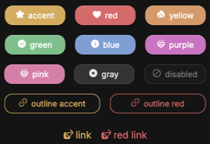

# フロントエンドユーティリティ

- [フロントエンドユーティリティ](#フロントエンドユーティリティ)
  - [はじめに](#はじめに)
  - [ボタンクラス](#ボタンクラス)
  - [レスポンシブプレフィックス](#レスポンシブプレフィックス)
  - [レイアウト](#レイアウト)
    - [ポジショニング](#ポジショニング)
    - [グリッド](#グリッド)
    - [フレックスボックス](#フレックスボックス)
  - [スペーシング](#スペーシング)
  - [サイジング](#サイジング)
  - [タイポグラフィ](#タイポグラフィ)
  - [アピアランス](#アピアランス)
  - [インタラクション](#インタラクション)
  - [トランジションとアニメーション](#トランジションとアニメーション)
  - [パフォーマンス](#パフォーマンス)
  - [dom関数](#dom関数)
    - [セレクション](#セレクション)
    - [イベント](#イベント)
    - [クラス](#クラス)
    - [フラグメントとマウント](#フラグメントとマウント)
    - [タイミング](#タイミング)
  - [データ関数](#データ関数)
    - [エスケープ](#エスケープ)
    - [型チェック](#型チェック)
    - [配列ユーティリティ](#配列ユーティリティ)
    - [その他](#その他)
  - [notifyとmodal](#notifyとmodal)
    - [notify](#notify)
    - [modal](#modal)

<a name="はじめに"></a>

## はじめに

dframeworkはスタイリングとDOM操作のための完全なユーティリティレイヤーを同梱しています。ユーティリティクラスはコンパイル時に生成されます。ランタイムのCSS in JSは一切使用しません。フロントエンド関数はすべてのページスクリプトおよびコンポーネントでグローバルに利用可能です。

<a name="ボタンクラス"></a>

## ボタンクラス

<p align="center">
  </img>
</p>

ベースクラス`btn`を使用し、続いてボタンの色を表すプレフィックスクラス`btn-*`を連結することで、あらかじめスタイル設定されたボタンを使用できます。

| 利用可能なカラー | 説明 |
| ------------------ | -------------------------------------- |
| `.btn-accent` | アクセントカラーのボタン |
| `.btn-red` | ソフトレッドのボタン |
| `.btn-yellow` | ソフトイエローのボタン |
| `.btn-green` | ソフトグリーンのボタン |
| `.btn-blue` | ソフトブルーのボタン |
| `.btn-purple` | ソフトパープルのボタン |
| `.btn-pink` | ソフトピンクのボタン |
| `.btn-gray` | `var(--container)`カラーのボタン |
| `.btn-transparent` | 透明ボタン（アニメーション用） |

<a name="レスポンシブプレフィックス"></a>

## レスポンシブプレフィックス

任意のユーティリティクラスにビューポートブレークポイントのプレフィックスを付加できます。プレフィックス付きクラスはビューポートが定義された幅以上になった場合にのみ適用されます。

| プレフィックス | 最小幅 |
| -------- | --------- |
| `sm:` | `480px` |
| `md:` | `768px` |
| `lg:` | `1024px` |
| `xl:` | `1280px` |
| `xxl:` | `1536px` |
| `ultra:` | `1920px` |

```html
<div class="flex-column md:flex-row g-1 md:g-2">content</div>
```

<a name="レイアウト"></a>

## レイアウト

### ポジショニング

| クラス | 説明 |
| ------------------------ | ---------------------------------------------------------------- |
| `.relative` | `position: relative` |
| `.fixed` | `position: fixed` |
| `.sticky` | `position: sticky` |
| `.absolute` | `position: absolute` |
| `.absolute-center` | translateによる絶対中央配置 |
| `.absolute-x-center` | 水平方向の絶対中央配置 |
| `.absolute-y-center` | 垂直方向の絶対中央配置 |
| `.absolute-fill` | 親要素全体を絶対配置で満たす |
| `.top-0` / `.bottom-0` | `top: 0` / `bottom: 0` |
| `.left-0` / `.right-0` | `left: 0` / `right: 0` |
| `.top-[05-100]` / `.bottom-[05-100]` | 5刻みのパーセンテージ指定の`top` / `bottom`（`top-05`、`top-10`〜`top-100`） |
| `.left-[05-100]` / `.right-[05-100]` | 5刻みのパーセンテージ指定の`left` / `right`（`left-05`、`left-10`〜`left-100`） |
| `.top-[1em-10em]` / `.bottom-[1em-10em]` | em単位ステップの`top` / `bottom`（`1em`〜`10em`） |
| `.left-[1em-10em]` / `.right-[1em-10em]` | em単位ステップの`left` / `right`（`1em`〜`10em`） |
| `.inset-0` | `top/right/bottom/left: 0`（positionの指定なし） |
| `.z-[0-auto]` | z-index: `0`、`1`、`2`、`3`、`4`、`5`、`10`、`50`、`100`、`auto` |

### グリッド

| クラス | 説明 |
| ---------------------- | -------------------- |
| `.grid-center` | 中央揃えグリッド |
| `.grid-2` | 2列グリッド |
| `.grid-3` | 3列グリッド |
| `.grid-4` | 4列グリッド |
| `.grid-auto` | 高密度オートフローグリッド |
| `.col-span-[1-4,full]` | グリッド列スパン |
| `.row-span-[1-3,full]` | グリッド行スパン |
| `.col-start-[1-4]` | グリッド列開始位置 |
| `.col-end-[1-4]` | グリッド列終了位置 |
| `.row-start-[1-3]` | グリッド行開始位置 |
| `.row-end-[1-3]` | グリッド行終了位置 |

### フレックスボックス

| クラス | 説明 |
| ------------------------------- | ------------------------------ |
| `.flex-row` | `flex-direction: row` |
| `.flex-column` | `flex-direction: column` |
| `.flex-center` | 両軸の中央揃え |
| `.flex-wrap` | `flex-wrap: wrap` |
| `.flex-1` | `flex: 1 1 0%` |
| `.flex-auto` | `flex: 1 1 auto` |
| `.flex-none` | `flex: none` |
| `.grow` / `.grow-0` | 個別flex-grow制御 |
| `.shrink` / `.shrink-0` | 個別flex-shrink制御 |
| `.order-[1-5]` / `.order-[first \| last \| none]` | flex/gridアイテムの順序 |
| `.justify-[start \| end \| center \| between \| around \| evenly]` | 主軸の配置 |
| `.align-[start \| end \| center \| baseline \| stretch]` | 交差軸の配置 |
| `.self-[start \| end \| center \| stretch \| baseline]` | 個別アイテムの交差軸配置 |

<a name="スペーシング"></a>

## スペーシング

すべてのスペーシングクラスで利用可能な値: `0`、`01`（`.1em`）、`02`（`.2em`）、`025`（`.25em`）、`03`（`.3em`）、`04`（`.4em`）、`05`（`.5em`）、`06`（`.6em`）、`07`（`.7em`）、`075`（`.75em`）、`08`（`.8em`）、`09`（`.9em`）、`1`、`125`、`15`、`175`、`2`、`25`（`2.5em`）、`3`から`10`まで（整数ステップ）。marginは`auto`も受け付けます。

| プレフィックス | 適用対象 |
| --------------- | -------------------- |
| `.p-` | 全方向パディング |
| `.px-` | 水平パディング |
| `.py-` | 垂直パディング |
| `.pt-` / `.pb-` | 上 / 下パディング |
| `.pl-` / `.pr-` | 左 / 右パディング |
| `.m-` | 全方向マージン |
| `.mx-` | 水平マージン |
| `.my-` | 垂直マージン |
| `.mt-` / `.mb-` | 上 / 下マージン |
| `.ml-` / `.mr-` | 左 / 右マージン |
| `.g-` | ギャップ（両軸） |
| `.gx-` | 列ギャップのみ |
| `.gy-` | 行ギャップのみ |

<a name="サイジング"></a>

## サイジング

| プレフィックス | 指定可能な値 |
| --------------------- | --------------------------------------------------------- |
| `.w-` | `0`、`05`〜`100`（5刻み%）、`05vw`〜`100vw`（5刻みvw）、`05svh`〜`100svh`（5刻みsvh）、スペーシングemスケール（`01em`〜`10em`）、`auto`、`min`、`max`、`fit` |
| `.h-` | `0`、`05`〜`100`（5刻み%）、`05svh`〜`100svh`（5刻みsvh）、`05vw`〜`100vw`（5刻みvw）、スペーシングemスケール（`01em`〜`10em`）、`auto`、`min`、`max`、`fit` |
| `.min-w-` / `.max-w-` | `.w-`と同様 |
| `.min-h-` / `.max-h-` | `.h-`と同様 |

<a name="タイポグラフィ"></a>

## タイポグラフィ

| クラス | 説明 |
| ------------------------------------------------ | ------------------------------------------------- |
| `.fs-[01-10]` | `.1em`から`10em`までのフォントサイズ（`.1em`刻み） |
| `.fw-[100-900]` | 100単位のfont-weight（100は極細、900は極太） |
| `.thin` | `font-weight: 300` |
| `.bold` | `font-weight: 700` |
| `.uppercase` / `.lowercase` / `.capitalize` | text-transform |
| `.italic` / `.not-italic` | font-style制御 |
| `.text-[left \| center \| right \| justify \| start \| end]` | テキストの配置 |
| `.text-vertical` | 縦書きモード |
| `.lh-[1-3]` | 行の高さ（1、1.1、1.15、1.2、1.25から3まで） |
| `.underline` / `.line-through` / `.no-underline` | テキスト装飾 |
| `.decoration-[dotted \| dashed \| wavy]` | text-decoration-style |
| `.underline-offset-[1 \| 2]` | `.1em`刻みのtext-underline-offset |
| `.truncate` | 省略記号による切り捨て（エイリアス） |
| `.overflow-ellipsis` | 省略記号による切り捨て |
| `.line-clamp-[1-4]` | N行で省略記号により切り捨て |
| `.indent-[1-3]` | em単位のtext-indent |
| `.whitespace-[pre \| pre-wrap \| pre-line \| normal \| nowrap]` | white-space制御 |
| `.break-words` / `.break-all` / `.break-keep` | 単語の改行制御 |

<a name="アピアランス"></a>

## アピアランス

| クラス | 説明 |
| --------------------------------------------- | ------------------------------------------------------------- |
| `.bdr-[0-2]` | `.1em`刻みのborder-radius |
| `.bdr-circle` | `border-radius: 50%` |
| `.border-[s \| m \| l]` | 全方向のボーダー |
| `.border-[top \| bottom \| left \| right \| x \| y]-[0 \| s \| m \| l]` | 方向指定ボーダー |
| `.bg-[color]` | 背景（`container`、`accent`、`red`、`blue`、`green`など） |
| `.text-[color]` | テキスト色（同等の値） |
| `.shadow-[s \| m \| l]` | ボックスシャドウ |
| `.opacity-[0, 05-100]` | 不透明度（5%刻み、`opacity-0`、`opacity-05`、`opacity-50`、`opacity-100`） |
| `.invert` | `filter: invert(1)` |
| `.grayscale` / `.grayscale-0` | グレースケールフィルターの適用 / 削除 |
| `.blur-[sm \| md \| lg \| xl]` | `filter: blur()` |
| `.brightness-[50 \| 75 \| 100 \| 125 \| 150]` | 明度フィルター |
| `.contrast-[50 \| 75 \| 100 \| 125 \| 150]` | コントラストフィルター |
| `.saturate-[0 \| 50 \| 100 \| 150 \| 200]` | 彩度フィルター |
| `.sepia` | セピアフィルター |
| `.hue-rotate-[15 \| 30 \| 60 \| 90 \| 180]` | 色相回転フィルター |
| `.filter-none` | すべてのフィルターを解除 |
| `.backdrop-blur-[sm \| md \| lg \| xl]` | バックドロップブラーフィルター |
| `.object-[cover \| contain \| fill \| none]` | 画像/動画のobject-fit |
| `.object-[center \| top \| bottom \| left \| right]` | 画像/動画の配置位置 |
| `.visible` / `.invisible` | 表示状態（レイアウトスペースを維持） |
| `.list-none` / `.list-disc` / `.list-decimal` | リストスタイルタイプ |
| `.list-inside` / `.list-outside` | リストスタイルの位置 |
| `.divide-y` / `.divide-x` | 子要素間のボーダー |
| `.table` | スタイル適用済みテーブル（ヘッダー、行、ホバー） |
| `.table-bordered` | ボーダー付き`.table`バリアント |
| `.table-striped` | 偶数奇数行の背景が交互に変わる`.table`バリアント |
| `.table-compact` | コンパクトなパディングの`.table`バリアント |
| `.table-auto` / `.table-fixed` | テーブルレイアウトモード |
| `.border-collapse` / `.border-separate` | ボーダーの重ね合わせモード |
| `.border-spacing-0` | border-spacingの削除 |
| `.table-caption` | テーブルキャプションのスタイリング |
| `.outline-none` | `outline: none` |

<a name="インタラクション"></a>

## インタラクション

| クラス | 説明 |
| -------------------------------------------------------------- | ---------------------------------- |
| `.pointer` | `cursor: pointer` |
| `.no-events` | `pointer-events: none` |
| `.click-haptic-[small \| med]` | クリック時のスケールダウンエフェクト |
| `.hover:bg-[color]` | ホバー時の背景色変更 |
| `.hover:text-[color]` | ホバー時のテキスト色変更 |
| `.shadow-hover-[s,m,l]` | ホバー時のシャドウ変更 |
| `.select-none` / `.select-text` / `.select-all` | user-select制御 |
| `.appearance-none` | ネイティブフォームスタイリングの解除 |
| `.float-left` / `.float-right` / `.float-none` | float |
| `.clear-both` / `.clear-left` / `.clear-right` / `.clear-none` | clear |
| `.align-top` / `.align-middle` / `.align-bottom` | vertical-align |
| `.align-text-top` / `.align-text-bottom` | vertical-align（テキスト相対） |
| `.align-sub` / `.align-super` | 下付き/上付き用vertical-align |

<a name="トランジションとアニメーション"></a>

## トランジションとアニメーション

| クラス | 説明 |
| --------------------------------- | -------------------------------------- |
| `.tr-[01-1]` | `.1s`から`1s`までのトランジション時間 |
| `.fade-[in,out]` | 不透明度トランジション |
| `.slide-in-[left,right,up,down]` | 開始方向からのスライドイン |
| `.slide-out-[left,right,up,down]` | 指定方向へのスライドアウト |
| `.preload` | すべてのトランジションを無効化 |

<a name="パフォーマンス"></a>

## パフォーマンス

これらのクラスはブラウザーにレンダリングのヒントを伝達します。頻繁に更新される複雑なコンテンツを持つ要素に適用してください。

| クラス | 説明 |
| ----------------- | ----------------------------------------------------------- |
| `.stable` | `will-change: transform; contain: paint` |
| `.self-contained` | `contain: layout paint` |
| `.isolated` | `contain: strict` |
| `.gpu` | `transform: translateZ(0); will-change: transform, opacity` |

<a name="dom関数"></a>

## dom関数

すべてのページスクリプトおよびコンポーネントで利用可能なグローバル関数です。ネイティブのブラウザーAPIよりもこちらを優先して使用してください。クリーンアップ関数を返し`dComponent`の自動クリーンアップシステムと統合されます。

### セレクション

```javascript
select('.btn-primary')
selectAll('.card')
select('.input', formElement)
```

### イベント

```javascript
const cleanup = listen(button, 'click', handler);
cleanup();

const cleanupAll = listenAll(selectAll('.btn'), 'click', handler);
cleanupAll();

unlisten(button, 'click', handler);
unlistenAll(selectAll('.btn'), 'click', handler);
```

### クラス

```javascript
addClass('active', el)
removeClass('hidden', el)
toggleClass('open', el, state)
hasClass('disabled', el)
```

<a name="フラグメントとマウント"></a>

### フラグメントとマウント

```javascript
const frag = createFragment('<div class="card"><span>title</span></div>');
appendMany(container, frag, '<div class="item">text</div>', customNode);
```

### タイミング

```javascript
await nextFrame();
await sleep(300);
```

<a name="データ関数"></a>

## データ関数

### エスケープ

```javascript
escapeHtml(v)
escapeJs(v)
```

### 型チェック

```javascript
isString(v)
isNumber(v)
isBoolean(v)
isArray(v)
isObject(v)
isFunction(v)
isEmpty(v)
hasValue(v)
```

### 配列ユーティリティ

```javascript
move(input, from, to)
remove(input, index)
replace(input, index, val)
limit(input, max)
uniquify(input)
asyncForEach(arr, fn)
```

### その他

```javascript
random(1, 100)
uniqueId(8)
clipboard('text to copy')
formatTime(seconds)
formatDate(date, false)
formatDate(date)
localizeDate(date, false)
localizeDate(date)
localizeDate(date, true, 'ja-JP', 'Asia/Tokyo')
distance(a, b)

Storage.get('key')
Storage.set('key', value)
Storage.remove('key')
Storage.clear()
```

<a name="notifyとmodal"></a>

## notifyとmodal

### notify

ノンブロッキングなトースト通知を表示します。タイマー満了後に自動消去されます。

```javascript
notify('profile updated');
notify('upload failed (please try again)', 6000);
```

通知要素にインタラクションを追加するにはセットアップコールバックを渡します。通知が閉じたときに自動クリーンアップを行うためコールバック内では`.listen()`を使用します:

```javascript
notify('<button class="undo-btn">undo</button>', 5000, (n) => {
  n.listen(n.querySelector('.undo-btn'), 'click', () => {
    undoLastAction();
    n.close();
  });
});

notify('<button class="undo-btn">undo</button>', (n) => {
  n.listen(n.querySelector('.undo-btn'), 'click', () => n.close());
});
```

### modal

フローティングモーダルを表示します。オープンアニメーションを処理し閉じた後にDOMから自身を削除します。

```javascript
modal('<h2>success</h2><p>your order has been placed.</p>');
```

インタラクティブなモーダルにはセットアップコールバックを渡します。自動クリーンアップには`.listen()`を使用します:

```javascript
modal(`
  <h2>delete post</h2>
  <p>this action cannot be undone.</p>
  <button class="btn-red confirm">delete</button>
  <button class="btn-gray cancel">cancel</button>
`, (m) => {
  m.listen(m.querySelector('.confirm'), 'click', async () => {
    await fetch(`/posts/${postId}`, { method: 'DELETE' });
    m.close();
    notify('post deleted');
  });

  m.listen(m.querySelector('.cancel'), 'click', () => m.close());
});
```
